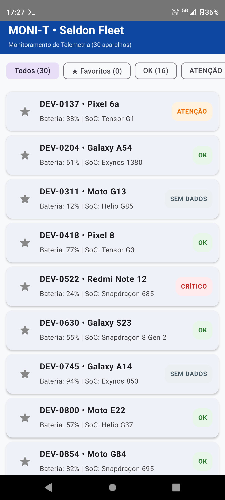
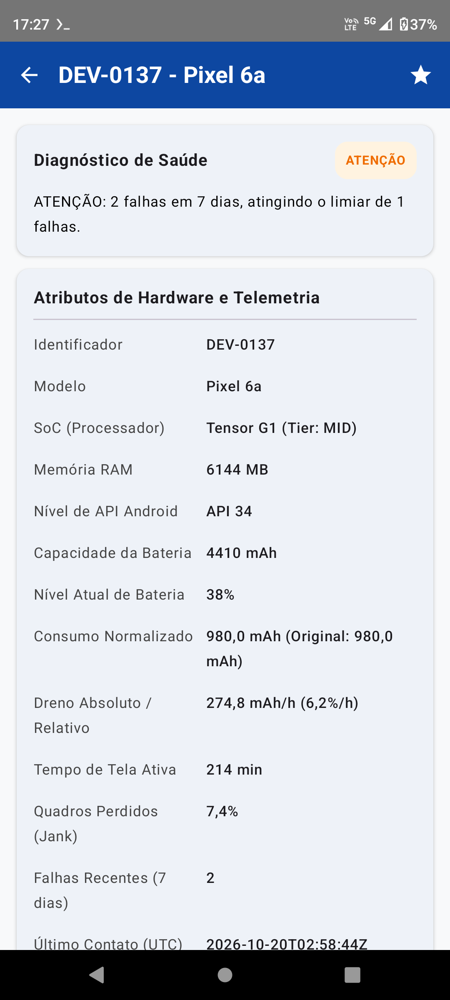

# MONI-T (Seldon Fleet) — Monitoramento e Diagnóstico de Telemetria Mobile

Desafio Técnico para o processo seletivo do **Projeto SELDON** (EST/UEA & Motorola) — **Trilha de Segurança de Dispositivos Móveis e Automação de Validações**.

---

## 1. Visão Geral do Projeto
O **MONI-T (Seldon Fleet)** é uma aplicação Android nativa desenvolvida em **Kotlin** e **Jetpack Compose**, estruturada sob os princípios de **Clean Architecture** para ingestão, normalização, classificação determinística e auditoria de telemetria de frotas de dispositivos móveis.

O sistema opera de forma **100% offline** (consumindo `app/src/main/assets/frota.json`), sem permissão de acesso à rede (`android.permission.INTERNET` ausente no manifesto), garantindo execução integral em modo avião e conformidade com os requisitos de segurança e privacidade (**REQ-01**).

---

## 2. Capturas de Tela (Execução em Dispositivo Físico Motorola)

| Tela 1 — Lista da Frota e Filtros por Status | Tela 2 — Diagnóstico Analítico e Telemetria |
| :---: | :---: |
|  |  |

* **Listagem e Filtros (REQ-05):** o app faz a listagem automatica dos 30 dispositivos da frota com contadores dinâmicos por categoria (`Todos (30)`, `OK (16)`, `ATENÇÃO (8)`, `CRÍTICO (4)`, `SEM DADOS (2)`, `★ Favoritos`), selos semânticos de cor, ordenação automática de favoritos no topo e limpeza em lote protegida por caixa de diálogo de confirmação via **Jetpack DataStore** (**REQ-07**).
* **Detalhe e Justificativa (REQ-06):** Exibe todos os atributos de hardware e telemetria, o consumo normalizado em `mAh`, as taxas de dreno horário (absoluto e relativo) e a justificativa textual determinística contendo os valores observados frente aos limiares do protocolo.

---

## 3. Arquitetura e Decisões de Engenharia

O projeto segue a separação estrita em três camadas:

~~~text
br.edu.uea.seldonfleet/
├── domain/     # Kotlin puro (Zero import android.*) — REQ-04
│   ├── model/          # Device, DeviceStatus (OK, ATENCAO, CRITICO, INDETERMINADO), ClassificationResult
│   ├── repository/     # Contrato DeviceRepository (Inversao de Dependencia)
│   └── usecase/        # ClassifyDevice (Regras matematicas, precedencia e guarda de divisores nulos)
├── data/       # Ingestao, Normalizacao e Persistencia Local
│   ├── dto/            # DeviceDto e FleetResponseDto (tolerantes a campos ausentes/nulos)
│   ├── mapper/         # DeviceMapper (conversao mWh -> mAh via nominalVoltage — REQ-02)
│   ├── source/         # AssetFleetSource (leitura offline de assets/frota.json — REQ-01)
│   └── repository/     # FleetRepositoryImpl (integracao Assets + Jetpack DataStore — REQ-07)
└── ui/         # Interface Reativa em Jetpack Compose
    ├── list/           # FleetListViewModel e FleetListScreen
    ├── detail/         # DeviceDetailScreen (preserva estado do filtro ao retornar)
    ├── theme/          # Paleta semantica de status
    └── StatusFormatter.kt # Traducao exclusiva de INDETERMINADO -> "SEM DADOS" na UI
~~~

---

## 4. Como Compilar, Testar e Executar

### Pré-requisitos
* **JDK 17** configurado no ambiente.
* O repositório inclui o **Gradle Wrapper (`./gradlew`)** oficial versionado.

### 1. Verificar Isolamento Arquitetural do Domínio (REQ-04)
~~~bash
grep -r "import android" app/src/main/java/br/edu/uea/seldonfleet/domain/
~~~
*(Resultado esperado: saída vazia — nenhuma dependência do framework Android no pacote `domain/`).*

### 2. Executar Suíte de Testes Unitários JVM e Auditoria Trilha B (REQ-08)
~~~bash
./gradlew test
~~~
Executa na JVM (sem necessidade de emulador):
* **`DeviceMapperTest`:** Equivalência física entre `mWh` e `mAh` (ex.: `DEV-0204` com `3773 mWh` a `3.85 V` convertidos para `980.0 mAh`), rejeição de tensões nulas/negativas e distinção estrita entre métricas ausentes (`null`) e zero real (`0.0` / `0`).
* **`ClassifyDeviceTest`:** Guardas contra divisão por zero (`batteryCapacityMah <= 0` como `DEV-0311`, `screenOnMinutes <= 0` como `DEV-0745`), análise de fronteiras completas imediatamente abaixo, exatamente no limiar e imediatamente acima (`6.99%`, `7.00%`, `7.01%` para `ATENCAO`; `11.99%`, `12.00%`, `12.01%` para `CRITICO`), precedência de sinais críticos e rejeição de métricas externas ausentes ou fora do intervalo físico (`jank` fora de `[0, 100]` ou `crashes < 0`).
* **`SecurityAuditTest`:** Verificação automatizada da **Trilha B**.

### 3. Executar Análise Estática (Android Lint — REQ-09)
~~~bash
./gradlew lintDebug
~~~

### 4. Gerar o Instalador APK de Debug
~~~bash
./gradlew assembleDebug
~~~
O arquivo compilado é gerado em `app/build/outputs/apk/debug/app-debug.apk` (e publicado automaticamente como artefato na aba **Actions** do GitHub).

---

## 5. Trilha B — Segurança de Dispositivos Móveis, Automação e LGPD (Seção 10)

1. **Hardening do `AndroidManifest.xml`:**
   * `android:allowBackup="false"` e `android:fullBackupContent="false"` (impede extração não autorizada de preferências locais via ADB backup).
   * `android:usesCleartextTraffic="false"` (bloqueia tráfego em texto claro por padrão).
   * Ausência de `android:debuggable="true"` fixado no manifesto e ausência de permissão `INTERNET`.
   * Controle explícito de superfície de ataque com `android:exported="true"` restrito exclusivamente à `MainActivity`.
2. **Auditoria Estática Automatizada no Build (`SecurityAuditTest.kt`):**
   * O teste falha a pipeline de CI caso qualquer arquivo `.kt` introduza chamadas de log (`Log.*`, `android.util.Log.*`, `Timber.*`, `Logger.*`, `println`, `System.out/err`) contendo identificadores de dispositivos (`device.id`, `dto.id`, `deviceId`, `DEV-XXXX`), cobrindo chamadas simples, **multilinha**, interpolação de strings e **aliasing em variável local**.
   * **Política estrita de supressão e limites do verificador:** Supressões exigem código de ticket e justificativa formal (`@SecurityAuditIgnore(reason="SEC-XXX: ...")`) e **jamais** isentam o acesso direto a propriedades `.id` de instâncias ou literais `DEV-XXXX` (permitindo apenas tratar falsos positivos em strings literais descritivas de schema). Os limites da verificação estática baseada em escopo local frente a análise de fluxo entre arquivos (AST Taint Analysis) são explicitamente testados e documentados na suíte.

---

## 6. Raciocínio de Desenvolvimento, Dificuldades Encontradas e Soluções

1. O fluxo de desenvolvimento foi arquitetado e executado a partir de um smartphone Motorola utilizando o terminal Linux **Termux** (`git` + `gh CLI`) via rede móvel, integrado ao **GitHub Actions** (`ubuntu-24.04` com JDK 17 e Gradle Wrapper) para compilação limpa, execução de Lint, bateria de testes JVM e geração do artefato `.apk`, instalado e validado diretamente no aparelho físico.
2. **Prevenção de Vazamento Semântico entre Domínio e UI:**
   * **Dificuldade:** O enunciado exige que o estado interno no domínio chame-se `INDETERMINADO`, mas que a interface exiba `SEM DADOS` e frases explicativas.

   * **Solução:** O caso de uso `ClassifyDevice` retorna códigos estruturados (`ReasonCode`), valores observados e limiares violados (`ReasonDetail`). A tradução para texto humano e cores ocorre exclusivamente em `ui/StatusFormatter.kt`, mantendo o domínio 100% puro.
3. **Distinção entre Dado Ausente e Zero Real:**
   * **Dificuldade:** Evitar que campos ausentes (`null`) no JSON fossem convertidos silenciosamente em `0` no mapeador, o que mascararia falhas de telemetria como se o aparelho estivesse saudável.
   * **Solução:** Preservação da nulidade semântica no `DeviceMapper` e validação explícita no `ClassifyDevice`, encaminhando qualquer métrica ausente ou fora dos limites físicos (`jank` fora de `[0%, 100%]` ou `crashes < 0`) para o estado `INDETERMINADO`.

---

## 7. Declaração de Uso de Inteligência Artificial e Contribuição Autoral

Em conformidade com as diretrizes de transparência do edital:

* **Ferramentas utilizadas:** **Google Gemini** (assistente de pareamento arquitetural, geração de código Kotlin/Compose e scripts de automação) e **ChatGPT** (utilizado de forma independente como auditor de *Code Review* para verificação de requisitos e casos de borda).
* **Onde a IA auxiliou:**
  1. Geração da estrutura de arquivos do Gradle, componentes visuais em Jetpack Compose, desenho vetorial XML do ícone adaptativo (visor de osciloscópio + símbolo de bateria) e expressões regulares do verificador estático da Trilha B.
  2. Revisão crítica cruzada apontando a necessidade de incluir os arquivos do Gradle Wrapper (`./gradlew`), expandir os testes de fronteira para cobrir valores imediatamente acima dos limiares e distinguir métricas ausentes de zero real.
* **Decisões, validações e condução minha (Desenvolvedor):**
  1. **Pré-registro e Inspeção dos Dados (`PROTOCOLO.md`):** Análise dos registros `DEV-0204` (`mWh`), `DEV-0311` (`batteryCapacityMah = 0`) e `DEV-0745` (`screenOnMinutes = 0`), decidindo manter dispositivos defeituosos visíveis sob `INDETERMINADO` para preservar a rastreabilidade dos números de aparelhos.
  2. **Arquitetura do Ambiente Mobile:** Configuração do ambiente Linux no Termux, autenticação SSH/GitHub CLI, execução dos commits e gerenciamento do pipeline de CI.
  3. **Direcionamento de Produto e Robustez:** Definição da identidade visual **MONI-T**, concepção do ícone de osciloscópio de bateria, criação da funcionalidade de limpeza em lote de favoritos em local estratégico com caixa de diálogo de confirmação (prevenindo toque acidental em frotas grandes) e exigência de validação contra dados externos negativos ou infinitos.
  4. **Testes e Validação em Dispositivo Real:** Instalação e inspeção funcional do APK no smartphone Motorola, conferindo contagens, filtros, persistência do DataStore e justificativas de cada aparelho.

---

## 8. O que eu, desenvolvedor do MONI-T, faria em seguida
1. **Ingestão Automatizada Offline-First:** Acoplar na camada `data/` uma fonte de sincronização em segundo plano via `WorkManager` ou injeção automatizada via ADB para bancadas de teste, mantendo o banco local como fonte única da verdade.
2. **Ponderação Contextual por *Tier* e Taxa de Atualização:** Parametrizar o limiar de `jankFramesPct` conforme a categoria do hardware (`low` 60 Hz vs. `high` 120 Hz) e isolar o dreno em *background* do dreno em tela ativa.
3. **Organização, estruturação:** Fazer uma pequena automatização de leitura, organização e validação rápida do **frota.json** antes de chegar a pasta 
**app/src/main/assets/**, assim já diagnosticando automaticamente dispositivos que poderão ter resultados e os indeterminados, garantindo uma melhor auditoria.